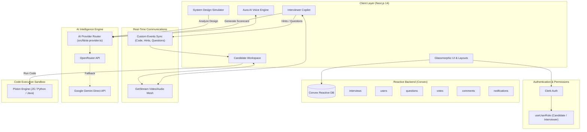
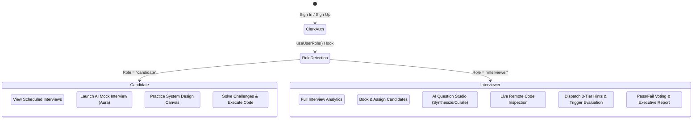
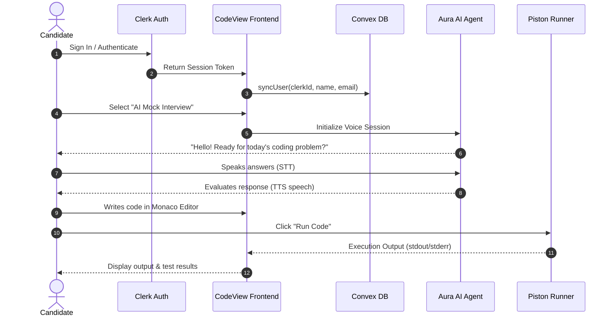
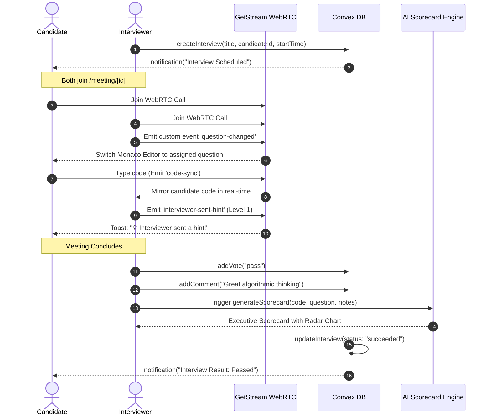
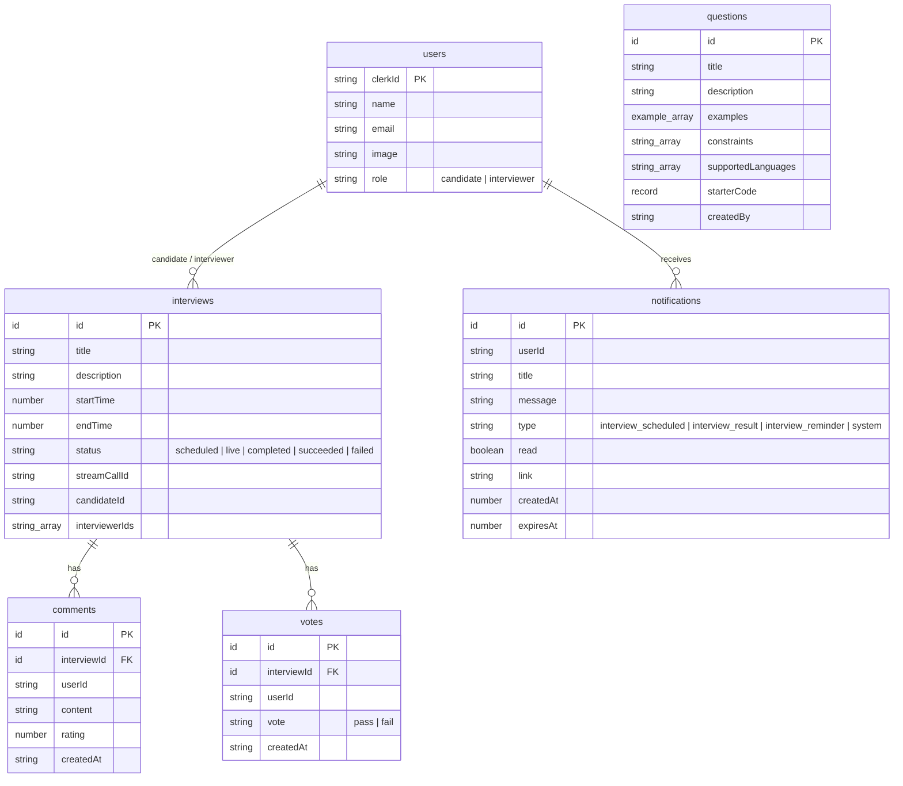
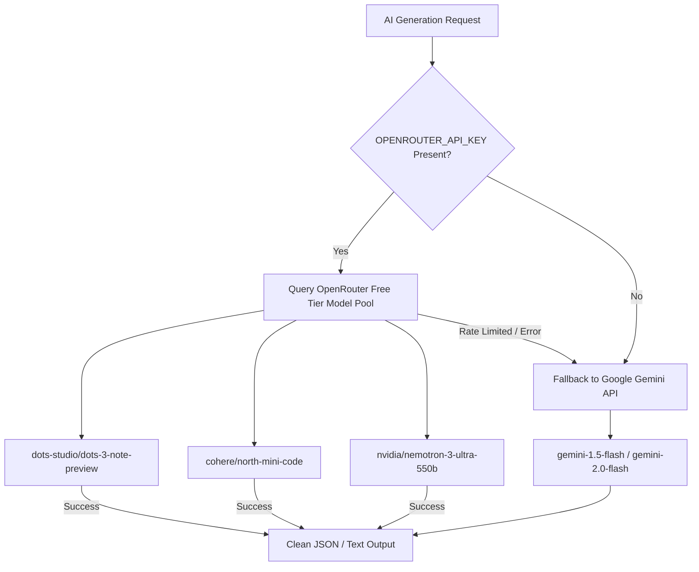

# CodeView — Project Flow & Comprehensive Architecture Guide

> **CodeView** is an enterprise-grade, AI-native technical interviewing and collaborative engineering platform. It merges ultra-low latency WebRTC video conferencing, synchronized multi-language code execution, interactive system design canvas simulation, voice-driven AI mock interviews, and automated executive scorecard generation.

---

## 1. Executive Summary & Core Mission

Traditional technical interviews suffer from fragmented tooling: video calls in one window, code sandboxes in another, architecture diagrams in third-party tools, and subjective evaluations scribbled in notes. 

**CodeView** unifies the entire engineering interview lifecycle into a single glassmorphic workspace:
1. **Live Collaborative Coding**: Real-time collaborative Monaco Editor, multi-language sandbox execution (JavaScript, Python, Java), live syntax & plagiarism analysis, and non-intrusive tiered hints.
2. **Aura — AI Voice Mock Interviewer**: Conversational AI powered by OpenRouter / Google Gemini with real-time speech recognition (STT) and voice synthesis (TTS) to provide pressure-free candidate preparation.
3. **Interactive System Design Studio**: Freeform canvas with 10+ cloud infrastructure primitives, live 100k QPS visual packet flow animation, auto-inferred networking protocols, and real-time AI architectural critique.
4. **Interviewer Copilot & Executive Scorecards**: Real-time AI evaluation generating hiring memos, radar skill breakdowns, code quality scores, and pass/fail consensus voting.
5. **Reactive Real-Time Infrastructure**: Powered by Convex serverless reactive database, Clerk identity management, GetStream audio/video WebRTC mesh, and Piston code execution API.

---

## 2. Technology Stack & External Services

| Domain | Technology / Provider | Key Responsibilities |
| :--- | :--- | :--- |
| **Framework & UI** | Next.js 14 (App Router), React 18, TypeScript | Server Components, API routes, Client Hydration, Layouts |
| **Styling & Design** | Vanilla CSS + Tailwind CSS, Framer Motion, Radix UI | Custom dark glassmorphism, floating navigation, fluid animations |
| **Real-Time Database** | **Convex** (`proper-malamute-792.convex.cloud`) | Reactive subscriptions, schema enforcement, transactional mutations |
| **Identity & Auth** | **Clerk** (`daring-weasel-31.clerk.accounts.dev`) | Session management, OAuth, multi-device auth, role assignment |
| **Video & WebRTC** | **GetStream** Video React SDK & Node SDK | Low-latency WebRTC video/audio, custom events mesh for code sync |
| **Code Editor** | Monaco Editor (`@monaco-editor/react`) | VS Code-grade code editing, syntax highlighting, theme switching |
| **Code Execution** | **Piston API** (Isolated sandbox runner) | Safe remote execution of JavaScript, Python, Java with custom I/O |
| **AI Intelligence** | **OpenRouter** (Free high-tier models) + **Google Gemini API** | Multi-model fallback for voice agent, architecture review, and scorecards |

---

## 3. High-Level System Architecture



---

## 4. Role System & Permission Matrix

CodeView supports a dual-persona model: **Candidate** and **Interviewer**.



### Permission Differences

| Feature / Screen | Candidate | Interviewer |
| :--- | :---: | :---: |
| **Home Dashboard** | View my interviews, stats, practice launchers | Full scheduling metrics, candidate lists, quick call setup |
| **Interview Scheduling** | View assigned scheduled calls | Pick candidate, set timeslot, configure interviewers |
| **Meeting Room (`/meeting/[id]`)** | Edit code, run test cases, receive hints | Assign question, inspect code live, send hints, vote pass/fail |
| **Interviewer Copilot Drawer** | Hidden | Access AI hint generator, code scrutiny, and interview rubric |
| **System Design Canvas** | Design architecture, run traffic simulation | Review architecture, critique components, trigger AI reviews |
| **Questions Studio (`/dashboard/questions`)** | Read-only questions list | Create manual questions, AI-generate algorithmic challenges |
| **Scorecard Generation** | View final scorecard after conclusion | Run AI scorecard analysis, write reviews, record votes |

---

## 5. Core Modules & Feature Breakdown

### 5.1. Live Collaborative Interview Room (`/meeting/[id]`)
- **WebRTC Grid**: Adaptive video/audio layout with participant mute, camera toggle, screen sharing, and participant roster.
- **Monaco Code Editor**:
  - Multi-language switcher: **JavaScript**, **Python**, **Java**.
  - Custom test-case input runner powered by the **Piston API**.
  - Plagiarism and AI code pattern analyzer.
- **Real-Time Remote Synchronization**:
  - Leverages GetStream custom event mesh (`question-changed`, `code-sync`, `interviewer-sent-hint`).
  - Remote code updates are throttled and diffed to avoid feedback loops.
- **3-Tier Adaptive Hint System**:
  - Interviewers can dispatch subtle, moderate, or explicit guidance without giving away the answer.
  - Candidate receives animated toast alerts with sound and badge.

### 5.2. Aura — AI Voice Mock Interviewer (`/mock-interview`)
- **Speech Recognition (STT)**: Uses Web Speech API with automatic interim transcription and candidate silence detection.
- **Voice Synthesis (TTS)**: Realistic audio playback using Web Speech Synthesis with natural cadence and tone matching.
- **Conversational Persona**: Aura acts as a supportive, FAANG-level interviewer who asks probing questions, explores edge cases, evaluates time complexity, and offers hints when the candidate gets stuck.

### 5.3. Interactive System Design Studio (`/system-design`)
- **10+ Architecture Primitives**: Clients, Load Balancers, API Gateways, Microservices, Relational DBs, NoSQL DBs, In-Memory Caches (Redis), Message Queues (Kafka/RabbitMQ), CDN, and S3 Blob Storage.
- **Live 100k QPS Traffic Simulation**:
  - Dynamically calculates QPS, latency (p50/p99), packet loss, and error rates based on components and connection topology.
  - SVG particle animation displays live animated packet flow across edges.
- **Protocol Auto-Inference**: Automatically detects whether connections represent `HTTP/REST`, `gRPC`, `WebSocket`, `TCP`, or `AMQP/Kafka`.
- **AI Architecture Critic**:
  - Evaluates system design against Single Points of Failure (SPOF), caching opportunities, read/write bottlenecks, and horizontal scale factors.
  - Generates a detailed drawer report with SLA compliance and health telemetry.

### 5.4. AI Question Studio & Question Bank (`/dashboard/questions`)
- **AI Algorithmic Synthesizer**: Generates challenges on demand based on topic (e.g. Dynamic Programming, Graphs, Concurrency) and difficulty (Easy, Medium, Hard).
- **Automated Test Scaffolding**: Produces problem description, constraints, example test cases with explanations, and boilerplate starter code for JavaScript, Python, and Java.
- **Resilient Fallback Engine**: If the Convex database is clean or empty, `CodeEditor.tsx` automatically falls back to standard challenges (`Two Sum`, `Reverse String`, `Palindrome Number`), guaranteeing that the application never breaks.

### 5.5. Executive Scorecard & AI Performance Analytics
- **Comprehensive Evaluation Memo**: Evaluates candidate performance across 5 key dimensions:
  1. Technical Competency & Correctness
  2. Problem Solving & Algorithmic Strategy
  3. System Thinking & Edge Cases
  4. Code Quality & Clean Architecture
  5. Communication & Clarification
- **Verdict & Hiring Memo**: Outputs `Strong Hire`, `Hire`, `Leaning Hire`, `Leaning No Hire`, or `Strong No Hire` with key strengths, red flags, and tailored development recommendations.

---

## 6. End-to-End User Journeys

### 6.1. Candidate Experience Flow



---

### 6.2. Live Interview & Evaluation Flow



---

## 7. Database Architecture (Convex Schema)

The persistent database schema is defined in [`convex/schema.ts`](file:///Users/blockstak/Projects/codeview/convex/schema.ts):



### Table Reference & Indexes

1. **`users`**:
   - Stores synced Clerk user documents and application roles (`candidate` or `interviewer`).
   - Indexed by: `by_clerk_id` on `["clerkId"]`.
2. **`interviews`**:
   - Manages meetings, live Stream call IDs, candidate IDs, and participant statuses.
   - Indexed by: `by_candidate_id` and `by_stream_call_id`.
3. **`comments`**:
   - Interviewer evaluation comments and numeric ratings (1–5 stars).
   - Indexed by: `by_interview` on `["interviewId"]`.
4. **`votes`**:
   - Official pass/fail votes cast by interviewers.
   - Indexed by: `by_interview` and `by_user`.
5. **`questions`**:
   - Question bank containing algorithmic problems, test cases, and starter code.
   - Indexed by: `by_created_by`.
6. **`notifications`**:
   - Real-time in-app alerts and schedule reminders.
   - Indexed by: `by_user` on `["userId", "createdAt"]`.

---

## 8. AI Provider Architecture (Multi-Model Resilience)

Located in [`src/lib/ai-provider.ts`](file:///Users/blockstak/Projects/codeview/src/lib/ai-provider.ts), the AI abstraction layer guarantees zero-downtime execution:



---

## 9. Code Repository Structure

```
codeview/
├── convex/                             # Backend Serverless Logic (Convex)
│   ├── auth.config.ts                  # Clerk JWT provider configuration
│   ├── comments.ts                     # Comment queries and mutations
│   ├── http.ts                         # Clerk Webhook route handler
│   ├── interviews.ts                   # Interview scheduling, status & deletion
│   ├── notifications.ts                # In-app notification engine
│   ├── questions.ts                    # Question bank CRUD operations
│   ├── schema.ts                       # Database schema definition
│   ├── users.ts                        # User synchronization & role queries
│   └── votes.ts                        # Pass/Fail consensus voting engine
│
├── src/
│   ├── actions/                        # Server Actions
│   │   ├── ai/
│   │   │   ├── architecture-critic.ts  # System design topology evaluator
│   │   │   ├── generate-question.ts    # AI coding challenge synthesizer
│   │   │   ├── generate-scorecard.ts   # Executive interview scorecard generator
│   │   │   ├── interviewer-copilot.ts  # Real-time hint & scrutiny assistant
│   │   │   └── voice-mock-agent.ts     # Aura voice mock conversational engine
│   │   ├── analyze-code.ts             # Plagiarism & complexity detector
│   │   ├── execute-code.ts             # Piston code sandbox API runner
│   │   └── stream.actions.ts           # GetStream token generator
│   │
│   ├── app/                            # Next.js App Router
│   │   ├── (admin)/
│   │   │   └── dashboard/              # Interviewer admin dashboard
│   │   │       └── questions/          # AI Question Studio & Question Bank
│   │   ├── (root)/
│   │   │   ├── (home)/                 # Candidate & Interviewer landing / home
│   │   │   ├── meeting/[id]/           # Live collaborative interview room
│   │   │   ├── mock-interview/         # Aura AI voice mock interview room
│   │   │   ├── recordings/             # Completed interviews & past recordings
│   │   │   ├── schedule/               # Interactive calendar & slot booking
│   │   │   └── system-design/          # System design canvas & simulation engine
│   │   ├── globals.css                 # Glassmorphism design tokens & styles
│   │   └── layout.tsx                  # Root layout, Clerk & Convex providers
│   │
│   ├── components/                     # React UI Components
│   │   ├── architecture/
│   │   │   └── SystemDesignCanvas.tsx  # Freeform canvas, QPS & packet flow
│   │   ├── evaluation/
│   │   │   └── ExecutiveScorecardView.tsx # Radar charts & evaluation memos
│   │   ├── interview/
│   │   │   ├── InterviewerCopilotDrawer.tsx # 3-tier hints & live code notes
│   │   │   └── InterviewerScorecardModal.tsx # Post-meeting scorecard modal
│   │   ├── questions/
│   │   │   ├── AddQuestionDialog.tsx   # Manual question creator dialog
│   │   │   ├── AiQuestionGeneratorModal.tsx # AI challenge generator modal
│   │   │   └── QuestionsList.tsx       # Question cards with edit/delete actions
│   │   ├── CodeEditor.tsx              # Monaco editor with collaborative sync
│   │   ├── MeetingRoom.tsx             # WebRTC meeting orchestrator
│   │   ├── MeetingSetup.tsx            # Camera & microphone pre-flight check
│   │   ├── Navbar.tsx                  # Floating navigation with role indicator
│   │   └── NotificationBell.tsx        # Real-time alert bell with dropdown
│   │
│   ├── constants/
│   │   └── index.ts                    # Baseline coding questions & time slots
│   ├── hooks/
│   │   ├── useUserRole.ts              # Candidate / Interviewer role controller
│   │   ├── useVoiceInterview.ts        # Aura speech recognition & synthesis
│   │   └── useMeetingActions.ts        # Join, leave, and end meeting actions
│   └── lib/
│       ├── ai-provider.ts              # Multi-model AI router (OpenRouter + Gemini)
│       └── utils.ts                    # CSS utility helpers (cn, formatting)
│
├── .env                                # Environment secrets & configuration
├── PROJECT_FLOW_AND_DESCRIPTION.md     # This comprehensive architecture document
└── package.json                        # Dependencies and npm scripts
```

---

## 10. Environment Configuration

The application requires the following environment variables in `.env`:

```bash
# Application URL
NEXT_PUBLIC_APP_URL=http://localhost:3000

# Convex Database
CONVEX_DEPLOYMENT=dev:proper-malamute-792
NEXT_PUBLIC_CONVEX_URL=https://proper-malamute-792.convex.cloud

# Clerk Authentication
NEXT_PUBLIC_CLERK_PUBLISHABLE_KEY=pk_test_...
CLERK_SECRET_KEY=sk_test_...
CLERK_WEBHOOK_SECRET=

# GetStream Video & Audio
NEXT_PUBLIC_STREAM_API_KEY=e59a...
STREAM_SECRET_KEY=caw6...
STREAM_API_SECRET=caw6...

# AI Intelligence Providers
OPENROUTER_API_KEY=sk-or-v1-...
GEMINI_API_KEY=AIzaSy...
```

---

## 11. Quickstart & Local Development

1. **Install Dependencies**:
   ```bash
   npm install
   ```
2. **Start Next.js Development Server**:
   ```bash
   npm run dev
   ```
3. **Open Application**:
   Navigate to [http://localhost:3000](http://localhost:3000) in your browser.
4. **Build Production Verification**:
   ```bash
   npx tsc --noEmit
   npm run build
   ```

---

## 12. Security & Compliance Measures

- **Authentication Guards**: Every mutation affecting meetings, comments, questions, or votes verifies `ctx.auth.getUserIdentity()`.
- **Sandboxed Execution**: Candidate code is submitted to an isolated Piston sandbox container with strict execution timeouts (5000ms) and memory limits, preventing remote code execution on the server.
- **Data Protection**: API keys for GetStream, OpenRouter, and Gemini are strictly kept on the server side (`src/actions/*`) and never leaked to the client bundle.
- **Fail-Safe Fallbacks**: In the event of an empty database or external API rate limits, both the coding challenge bank and the AI provider gracefully fall back to local constants and secondary API providers.
